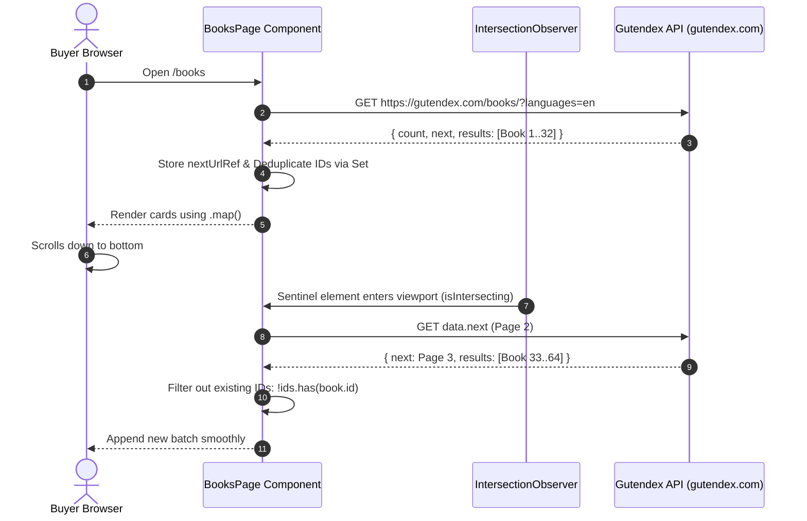

# PageTurner Bookstore Web Application

> A modern, full-stack Bookstore web application built with **React.js**, **Next.js (App Router)**, **TypeScript**, **Ant Design**, **Redux Toolkit**, **MongoDB with Mongoose**, and the **Gutendex API (Project Gutenberg)** featuring **Infinite Scrolling** with `IntersectionObserver`.

---

## 📚 Table of Contents
1. [Project Overview](#-project-overview)
2. [Technology Stack](#-technology-stack)
3. [Key Features & User Journeys](#-key-features--user-journeys)
4. [Gutendex API & Infinite Scroll Architecture](#-gutendex-api--infinite-scroll-architecture)
5. [Computer Science & Data Structures (DSA) Implementations](#-computer-science--data-structures-dsa-implementations)
6. [Backend Architecture & Route Handlers](#-backend-architecture--route-handlers)
7. [Authentication & Security](#-authentication--security)
8. [Folder Structure](#-folder-structure)
9. [Git Workflow & Branching Strategy](#-git-workflow--branching-strategy)
10. [Local Development Setup](#-local-development-setup)
11. [Testing & API Documentation (Swagger & Postman)](#-testing--api-documentation)
12. [Vercel Deployment Guide](#-vercel-deployment-guide)

---

## 🌟 Project Overview

**PageTurner** is designed as a clean, production-ready bookstore application suitable for academic demonstration, technical viva, and live production deployment.

Instead of an overcomplicated separate Express service, this application leverages **Next.js App Router Route Handlers** for serverless backend execution, paired with **MongoDB Atlas** for data persistence.

It uniquely balances two book discovery paradigms:
1. **External Public E-Library:** Connects directly to the **Gutendex API** (`https://gutendex.com/books/`), streaming over 10,000+ public domain classic titles progressively using **Infinite Scrolling** (`IntersectionObserver`).
2. **Commercial Bookstore Inventory:** Stores local commercial editions with real USD pricing, ratings, stock counts, and ISBNs in MongoDB, featuring a full admin CRUD management suite.

---

## 🛠 Technology Stack

| Layer | Technologies |
| :--- | :--- |
| **Frontend Framework** | React 18, Next.js 14 (App Router) |
| **Language** | TypeScript (Strict mode enabled) |
| **Component Library** | Ant Design (v5) with `@ant-design/nextjs-registry` SSR |
| **Global State Management** | Redux Toolkit (`@reduxjs/toolkit`, `react-redux`) with LocalStorage hydration |
| **Data Fetching** | Axios (centralized instance with interceptors) & Native Fetch |
| **Database & ODM** | MongoDB with Mongoose |
| **Authentication** | JSON Web Tokens (JWT) stored in HTTP-Only Cookies, Passwords hashed via Bcrypt.js |
| **Server Logging** | Winston Logger (Sanitized, password/token redacted) |
| **External API** | Gutendex (Project Gutenberg Metadata API) |
| **Deployment Target** | Vercel (Frontend & Serverless API Routes) |

---

## 🚀 Key Features & User Journeys

### 1. Buyer Journey 🛒
- **Home Page:** Hero section, book search bar, featured commercial bestsellers, trending Gutenberg classics, and category explorer.
- **Book Catalog (`/books`):**
  - **Infinite Scroll:** Progressively loads books in batches using the native browser `IntersectionObserver`.
  - **Duplicate Prevention:** Strips out duplicate book IDs using a JavaScript `Set`.
  - **Filters:** Search by title/author, filter by genre, and sort by popularity, title, or ID.
  - **Tab Switcher:** Toggle between *Gutenberg Ebooks* and *Commercial Store Inventory*.
- **Book Details (`/books/[id]`):** Dynamic routing displaying book cover, author information, download counts, language, subject tags, format reader links (EPUB, HTML), quantity selector, and purchase actions.
- **Shopping Cart (`/cart`):** Add/remove books, adjust quantities, calculate subtotal and tax via `reduce()`, persist items in `localStorage`, and undo removals via **Stack (LIFO)**.
- **Wishlist (`/wishlist`):** Save favorite books with duplicate prevention via `Set`, with a one-click "Move to Cart" button.
- **Checkout (`/checkout`):** Validated shipping address form, simulated payment option, and order placement.
- **Order Queue Confirmation:** Generates order ID and places order into the FIFO fulfillment queue.
- **Order History (`/orders`):** Lists user's past purchases retrieved from MongoDB.

### 2. Admin Journey ⚙️
- **Admin Dashboard (`/admin`):**
  - KPI overview: Total titles, stock units, orders placed, gross revenue.
  - **CRUD Book Management:** Add, edit, and delete commercial bookstore inventory.
  - **Order Queue Monitoring:** View all customer orders and their live queue status.
  - Access restricted via JWT role verification (`role === 'admin'`).

---

## 🔄 Gutendex API & Infinite Scroll Architecture

Based directly on `Bookstore_API_Infinite_Scroll_Guide.pdf`:



### Key Technical Implementation Details:
1. **Next URL Traversal:** Instead of calculating manual page numbers (`?page=N`), the app follows `data.next` until it equals `null`.
2. **Overlap Prevention:** A boolean ref (`loadingRef.current`) locks duplicate calls when the sentinel remains in view during slow network responses.
3. **`Set` Deduplication:**
   ```typescript
   setBooks((previous) => {
     const ids = new Set(previous.map((book) => book.id));
     return [...previous, ...data.results.filter((book) => !ids.has(book.id))];
   });
   ```
4. **Retry & Error Handling:** When requests fail, an Ant Design `Alert` with a "Retry" button appears, allowing the user to resume without losing already-loaded books.
5. **Clean Reset on Search:** Whenever the search input or genre filter changes, existing books and pagination states are cleared before fetching the new query.

---

## 🧠 Computer Science & Data Structures (DSA) Implementations

The project fulfills all required data structure concepts in practical, idiomatic JavaScript (located in `src/lib/dsa.ts`):

| Concept | File Location | Application in Project |
| :--- | :--- | :--- |
| **`map()`** | `src/components/books/BookCard.tsx`, `CartPage.tsx` | Transforms arrays of book objects into Ant Design UI cards and table rows. |
| **`filter()`** | `src/app/books/page.tsx`, `src/lib/dsa.ts` | Filters books by search query, price range, and selected genre. |
| **`reduce()`** | `src/store/cartSlice.ts`, `src/app/cart/page.tsx` | Calculates order subtotal, tax, and item count from cart items array. |
| **`Set`** | `src/store/wishlistSlice.ts`, `src/app/books/page.tsx` | 1) Enforces unique wishlist entries in $O(1)$ time.<br>2) Prevents duplicate book IDs during infinite scroll pagination. |
| **`Map`** | `src/lib/dsa.ts` (`BookLookupMap`) | High-speed in-memory key-value cache mapping ISBN $\to$ Book object for $O(1)$ lookups. |
| **`Stack` (LIFO)** | `src/store/cartSlice.ts` (`undoStack`) | **Cart Undo Feature:** Pushes cart state onto a stack when an item is deleted. Clicking "Undo" pops the previous state back. |
| **`Queue` (FIFO)** | `src/lib/dsa.ts` (`globalOrderQueue`) | **Order Fulfillment Queue:** When orders are created during checkout, they enter a First-In, First-Out queue (`enqueue`). Displays position `#1`, `#2`, etc. |
| **Hash Table Lookup** | `src/models/Book.ts`, `src/app/api/books/[id]` | Indexed `isbn` field in MongoDB provides $O(1)$ direct retrieval of commercial books. |
| **Tree Structure** | `src/components/books/CategoryTree.tsx` | Ant Design `Tree` hierarchical category navigation (Fiction $\to$ Classics, Sci-Fi; Non-Fiction $\to$ Science, History). |

---

## 🔌 Backend Architecture & Route Handlers

All APIs are written using Next.js Route Handlers (`src/app/api/...`):

### 1. Authentication Endpoints
- `POST /api/auth/register` — Validates inputs, hashes password using bcrypt, stores user, sets HTTP-only JWT cookie.
- `POST /api/auth/login` — Verifies password, returns user object, and sets HTTP-only cookie.
- `GET /api/auth/me` — Reads current session from cookie.
- `POST /api/auth/logout` — Destroys session cookie (`maxAge: 0`).

### 2. Commercial Book Endpoints
- `GET /api/books` — Lists commercial books with search, genre, and limit filters. Auto-seeds default books if empty.
- `POST /api/books` — Protected: Admin-only creation of commercial titles.
- `GET /api/books/[id]` — Retrieves book by MongoDB ObjectId or ISBN.
- `PATCH /api/books/[id]` — Protected: Admin-only update of stock, price, or details.
- `DELETE /api/books/[id]` — Protected: Admin-only deletion.

### 3. Order Endpoints
- `GET /api/orders` — Returns orders for current authenticated user (or all orders if admin).
- `POST /api/orders` — Creates order in MongoDB and enqueues in FIFO order processing queue.

---

## 🔒 Authentication & Security

- **JWT Cookies:** Auth tokens are stored in `httpOnly`, `sameSite: 'lax'`, and `secure` (in production) cookies named `bookstore_token`. This protects against Cross-Site Scripting (XSS) attacks.
- **Bcrypt Password Hashing:** User passwords are never saved in plain text. A salt factor of 10 is applied.
- **Winston Logger Sanitization:** The server logger automatically redacts sensitive keys (`password`, `token`, `secret`, `cookie`) before outputting logs to the console or log files.

---

## 📁 Folder Structure

```
BookStore/
├── public/
│   ├── openapi.json                  # OpenAPI / Swagger 3.0 specification
├── src/
│   ├── app/
│   │   ├── layout.tsx                # Root layout with AntdRegistry & Redux Provider
│   │   ├── page.tsx                  # Home Page (Hero, Featured, Categories)
│   │   ├── globals.css               # Tailwind CSS directives & custom styles
│   │   ├── books/
│   │   │   ├── page.tsx              # Catalog with Gutendex Infinite Scroll & Filters
│   │   │   └── [id]/page.tsx         # Dynamic Book Details page
│   │   ├── cart/page.tsx             # Shopping Cart with reduce() and Stack Undo
│   │   ├── wishlist/page.tsx         # Wishlist page with Set duplicate prevention
│   │   ├── checkout/page.tsx         # Simulated checkout and order confirmation
│   │   ├── orders/page.tsx           # Order History retrieved from MongoDB
│   │   ├── login/page.tsx            # Login with quick viva demo buttons
│   │   ├── register/page.tsx         # Customer registration
│   │   ├── admin/page.tsx            # Protected Admin Dashboard (CRUD & Queue)
│   │   ├── docs/page.tsx             # Interactive Swagger / API documentation page
│   │   └── api/                      # Next.js Route Handlers
│   │       ├── auth/
│   │       │   ├── login/route.ts
│   │       │   ├── logout/route.ts
│   │       │   ├── me/route.ts
│   │       │   └── register/route.ts
│   │       ├── books/
│   │       │   ├── route.ts
│   │       │   └── [id]/route.ts
│   │       ├── cart/route.ts
│   │       └── orders/route.ts
│   ├── components/
│   │   ├── layout/
│   │   │   ├── Navbar.tsx
│   │   │   ├── Footer.tsx
│   │   │   └── AntdRegistryWrapper.tsx
│   │   └── books/
│   │       ├── BookCard.tsx
│   │       ├── CommercialBookCard.tsx
│   │       └── CategoryTree.tsx
│   ├── lib/
│   │   ├── auth.ts                   # JWT & bcrypt utilities
│   │   ├── axios.ts                  # Centralized Axios client instance
│   │   ├── dsa.ts                    # Computer science & DSA practical utilities
│   │   ├── logger.ts                 # Winston server logger with redaction
│   │   ├── mongodb.ts                # Cached Mongoose connection
│   │   └── sampleBooks.ts            # Default commercial bookstore dataset
│   ├── models/
│   │   ├── Book.ts                   # Commercial Book Mongoose schema
│   │   ├── Order.ts                  # Order Mongoose schema
│   │   └── User.ts                   # User Mongoose schema
│   ├── store/
│   │   ├── index.ts                  # Redux Toolkit store configuration
│   │   ├── hooks.ts                  # Typed useAppDispatch & useAppSelector
│   │   ├── StoreProvider.tsx         # Client provider with localStorage hydration
│   │   ├── authSlice.ts              # Auth state slice
│   │   ├── cartSlice.ts              # Cart slice with Stack Undo
│   │   └── wishlistSlice.ts          # Wishlist slice with Set uniqueness
│   └── types/
│       └── index.ts                  # TypeScript definitions and interfaces
├── .env.example                      # Environment variables template
├── .gitignore                        # Git exclusion rules
├── bookstore.postman_collection.json # Exported Postman collection
├── next.config.mjs                   # Next.js configuration
├── package.json                      # Project dependencies & scripts
├── tailwind.config.ts                # Tailwind CSS configuration
└── tsconfig.json                     # TypeScript compiler options
```

---

## 🌿 Git Workflow & Branching Strategy

The repository follows a clean industry-standard Git workflow:

```
main (production-ready code)
  ↑
develop (integration branch)
  ↑
feature/* (feature development branches)
```

### Git Branches in this Repository:
- `main`: Deployment-ready production code.
- `develop`: Integration branch.
- Feature Branches:
  - `feature/book-catalog`: Infinite scroll and Gutendex integration.
  - `feature/cart-wishlist`: Redux Toolkit cart, Stack undo, and Set wishlist.
  - `feature/authentication`: JWT auth, bcrypt hashing, and protected routes.
  - `feature/admin-dashboard`: Commercial books CRUD and order queue.

---

## 💻 Local Development Setup

### 1. Prerequisites
- Node.js (v18.17+ or v20+)
- npm or yarn
- MongoDB Atlas connection string (or local MongoDB running on `mongodb://127.0.0.1:27017/bookstore`)

### 2. Clone and Install
```bash
git clone <your-repo-url>
cd BookStore
npm install
```

### 3. Configure Environment Variables
Create a `.env.local` file in the root directory (based on `.env.example`):
```env
# MongoDB Connection URI (Atlas or Local)
MONGODB_URI=mongodb+srv://<username>:<password>@cluster0.mongodb.net/bookstore?retryWrites=true&w=majority

# JWT Authentication Secret Key (minimum 32 characters)
JWT_SECRET=super_secret_jwt_key_change_in_production_min_32_chars

# Optional Port and Base URL configuration
NEXT_PUBLIC_APP_URL=http://localhost:3000

# Initial Admin Credentials
ADMIN_EMAIL=admin@bookstore.com
ADMIN_PASSWORD=Admin@123456
ADMIN_NAME=Store Manager
```

### 4. Run Development Server
```bash
npm run dev
```
Open [http://localhost:3000](http://localhost:3000) in your browser.

---

## 🧪 Testing & API Documentation

### 1. Interactive Swagger / OpenAPI Page
Visit the in-app documentation at:
```
http://localhost:3000/docs
```
You can view all endpoints, inspect schemas, and test live requests with the **"Try Request"** button.

### 2. Postman Collection
Import `bookstore.postman_collection.json` located in the root directory directly into Postman to test all endpoints.

### 3. Demo Credentials
- **Admin Account:** `admin@bookstore.com` / `Admin@123456`
- **Customer Account:** `reader@bookstore.com` / `Reader@123456`
*(On the `/login` page, click "Fill Admin Account" or "Fill Customer Account" for instant one-click login during viva).*

---

## 🚀 Vercel Deployment Guide

Deploying PageTurner to Vercel takes under 3 minutes:

1. **Push your code to GitHub:**
   ```bash
   git add .
   git commit -m "feat: complete bookstore full-stack application"
   git push origin main
   ```
2. **Log into [Vercel](https://vercel.com):**
   - Click **"Add New"** $\to$ **"Project"**.
   - Select your GitHub repository (`BookStore`).
3. **Configure Environment Variables in Vercel:**
   Add the following variables in the Vercel project settings:
   - `MONGODB_URI` — Your MongoDB Atlas production connection string.
     *(Ensure Network Access in MongoDB Atlas has `0.0.0.0/0` whitelisted so Vercel serverless functions can connect).*
   - `JWT_SECRET` — A secure random string (e.g. 64 characters).
   - `ADMIN_EMAIL` — `admin@bookstore.com`
   - `ADMIN_PASSWORD` — A strong password for initial admin initialization.
4. **Deploy:**
   - Click **Deploy**. Vercel will run `next build` and publish your live bookstore URL.
